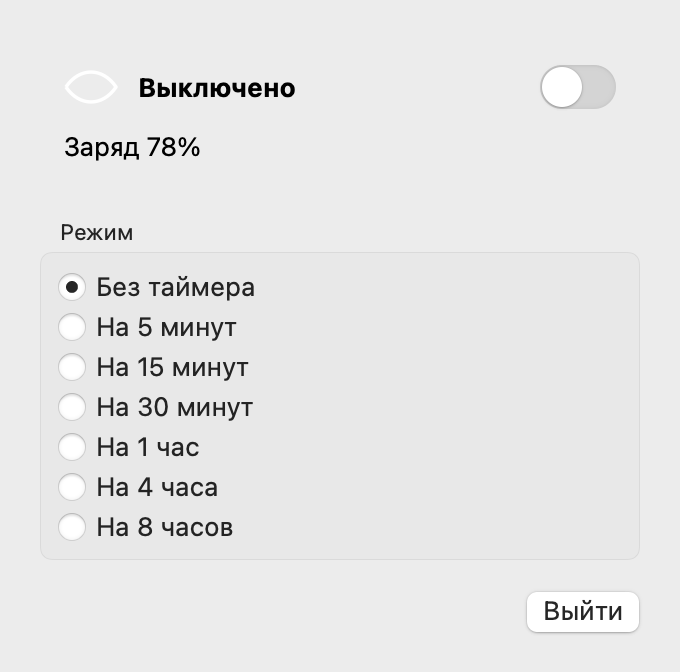
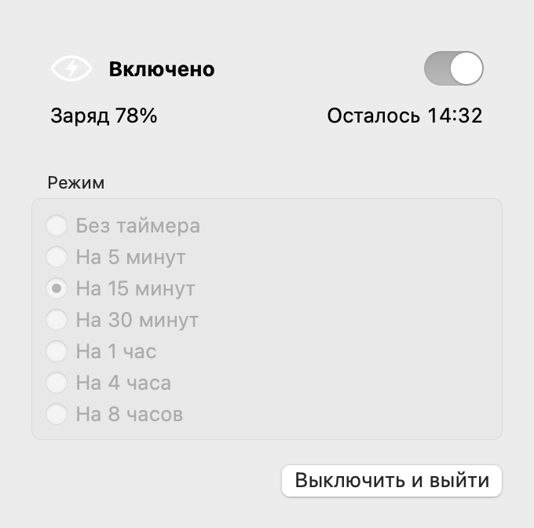

# Don’t Sleep

[](https://github.com/frendip/dont-sleep/actions/workflows/ci.yml)

Нативная утилита для macOS, которая позволяет MacBook продолжать работу с закрытой крышкой. Подходит для долгих сборок, загрузок и фоновых задач: выберите срок и включите режим через значок глаза в верхней панели или компактное окно.

## Возможности

- **Семь режимов:** без таймера, 5, 15, 30 минут, 1, 4 или 8 часов.
- **Раздельные выбор и запуск:** сначала выберите режим, затем включите переключатель. Во время работы выбор заблокирован; для нового срока выключите режим и включите снова.
- **Защита по заряду:** на аккумуляторе включение разрешено строго выше 20%; при 20% и ниже начинается восстановление сна. При питании от сети ограничения по проценту нет.
- **Проверяемое выключение:** выключатель, истечение таймера и обычный выход восстанавливают собственные изменения приложения. При ошибке интерфейс показывает её и блокирует новое включение.
- **Независимое восстановление:** две системные службы контролируют сессию; журнал позволяет восстанавливать сон после сбоя. После перезапуска сессия сама не возобновляется.
- **Доступное окно управления:** повторное открытие `.app` возвращает окно, даже если значок скрыт за вырезом камеры. Крестик скрывает окно, сохраняя работу приложения.
- Светлая и тёмная темы macOS, заряд и оставшееся время, один экземпляр приложения, без иконки в Dock и автозапуска интерфейса.

## Окно управления

 

Состояния текущего окна на тестовых данных, отрисованные встроенным renderer. Внеэкранный снимок передаёт системные материалы и акценты не полностью; это иллюстрация компоновки и поведения. Меню в верхней панели использует другой вид строк с галочкой.

## Статус и совместимость

**Локальная экспериментальная сборка для Apple Silicon.** Версия текущего исходного дерева указана в [Info.plist](Resources/Info.plist), изменения — в [журнале](CHANGELOG.md), правила выпуска — в [документации](docs/development.md#версии-и-выпуски). Скрипт собирает ARM64; минимальная версия в пакете — macOS 13. Для сборки нужны инструменты разработки Apple с `swift`, `xcrun`, `codesign` и SDK, содержащим API macOS 26 (`glassEffect`). Проверено на Xcode 27.0, Swift 6.4 и macOS SDK 27.0. Объявление Swift tools 5.9 в пакете не означает, что старого компилятора достаточно. Внешних зависимостей нет. Минимальная версия сборки не означает проверенную совместимость со всеми Mac.

В журнале приёмки зафиксирована пользовательская проверка интерфейса, режимов, обычного выхода и работы с закрытой крышкой на MacBook Pro M4 Pro (целевая macOS 26.7.1), 11 октября 2026 года. Реальные аварии установленных служб, восстановление после перезагрузки и энергопотребление ещё требуют отдельных испытаний. Подробности и результаты автоматических проверок — в [статусе проверки](docs/validation.md).

Сборка подписывается локально (ad-hoc), без нотарификации. DMG собирается при выпуске по тегу; он требует ручного разрешения первого запуска в macOS. Наличие workflow не означает, что выпуск уже опубликован.

## Установка из DMG

Опубликованные сборки доступны в [GitHub Releases](https://github.com/frendip/dont-sleep/releases). Скачайте `DontSleep-macos-arm64.dmg`, откройте образ и перетащите `Don’t Sleep.app` на ссылку **Applications**. Извлеките образ и запускайте приложение из «Программ».

Сборка имеет локальную подпись ad-hoc, **без Developer ID и нотарификации Apple**. Если macOS блокирует первый запуск из-за неизвестного разработчика или отсутствия проверки Apple, после попытки открытия перейдите в **Системные настройки → Конфиденциальность и безопасность → Всё равно открыть (Open Anyway)**. Подтвердите запуск только для намеренно скачанного приложения из этого репозитория. Затем нажмите **«Настроить…»** в приложении и подтвердите установку служб паролем администратора.

[Полная инструкция первого запуска](docs/installation.txt) также лежит внутри DMG и в описании релиза. Совместимость текущей сборки — только Apple Silicon; ограничения проверки перечислены выше.

## Сборка из исходников и первый запуск

Из каталога проекта:

```sh
./scripts/build-app.sh
open 'dist/Don’t Sleep.app'
```

Сборка создаёт `dist/Don’t Sleep.app`, проверяет подписи и установочное содержимое. Она не устанавливает службы и не меняет настройки питания. Приложение можно запускать из `dist` или перенести целиком в «Программы».

1. В открывшемся окне нажмите **«Настроить…»** и подтвердите системный запрос администратора для установки служб.
2. Дождитесь подтверждённого состояния **«Выключено»**.
3. Выберите срок и включите верхний переключатель. Дождитесь **«Включено»**.
4. Для завершения выключите переключатель либо выберите **«Выключить и выйти»** / ⌘Q. Дождитесь подтверждения восстановления.

После изменения подписанного кода повторите настройку новой сборки: службы доверяют конкретному пользователю и точным хешам приложения и служебных компонентов. Не смешивайте компоненты разных сборок.

Закрытый работающий MacBook оставляйте на открытой поверхности, не в сумке. Экран блокируйте самостоятельно. Предотвращение сна не гарантирует доступность интернета или продолжение любой сторонней задачи; работающий Mac расходует энергию.

## Проверки и документация

[GitHub Actions](https://github.com/frendip/dont-sleep/actions/workflows/ci.yml) запускает тесты и release-сборку ARM64 на каждом PR и push в `main`. Прогон проверяет сборку с ad-hoc подписью и её запуск, без нотарификации и установки служб; архивы приложения в Actions не сохраняются. Workflow [Release](https://github.com/frendip/dont-sleep/actions/workflows/release.yml) отдельно проверяет тег версии, собирает DMG и создаёт **черновик** GitHub Release. Подробнее — [CI и артефакты](docs/development.md#ci-и-артефакты).

```sh
./scripts/test-safe.sh
```

Это Swift- и Python-тесты с подставными исполнителями и временными файлами, тесты подготовки выпуска в отдельных временных Git-репозиториях, проверка синтаксиса shell-скриптов и plist. Они не устанавливают службы и не меняют настройки сна. Для Python-тестов нужен `python3` по пути `/usr/bin/python3`.

- [Руководство пользователя](docs/user-guide.md) — режимы, питание, окно, обновление.
- [Решение проблем и удаление](docs/troubleshooting.md) — статусы, диагностика, штатный деинсталлятор.
- [Разработка](docs/development.md) — устройство проекта, сборка, проверки и превью.
- [Архитектура](docs/architecture.md) — процессы, протокол v2, доверие и восстановление.
- [Статус проверки](docs/validation.md) и [измерение энергии](docs/energy.md) — что подтверждено и что ещё предстоит проверить.
- [Состав репозитория](docs/repository.md) — что хранится в Git и что остаётся локально.
